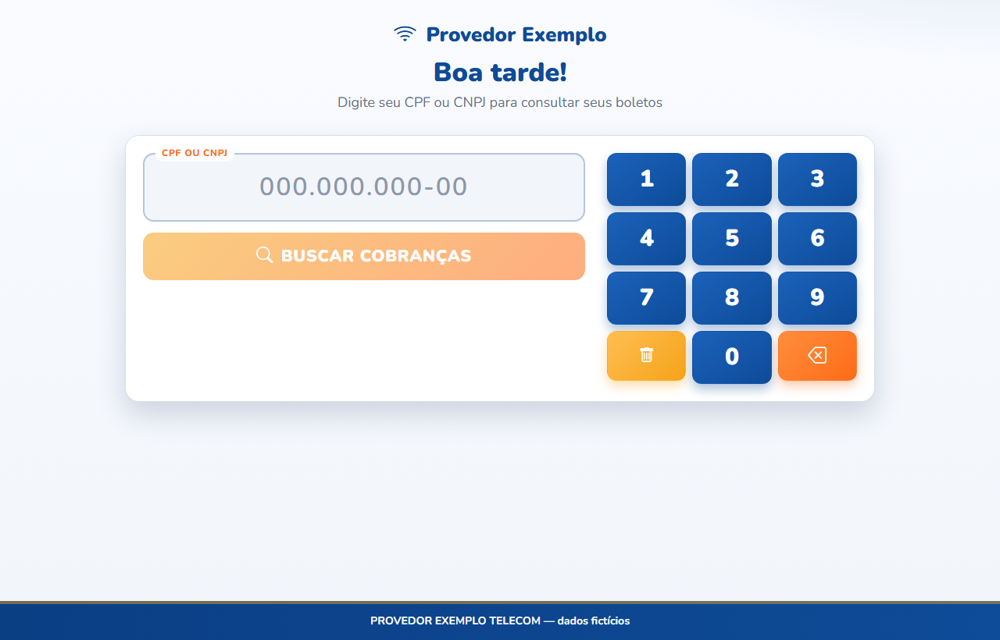
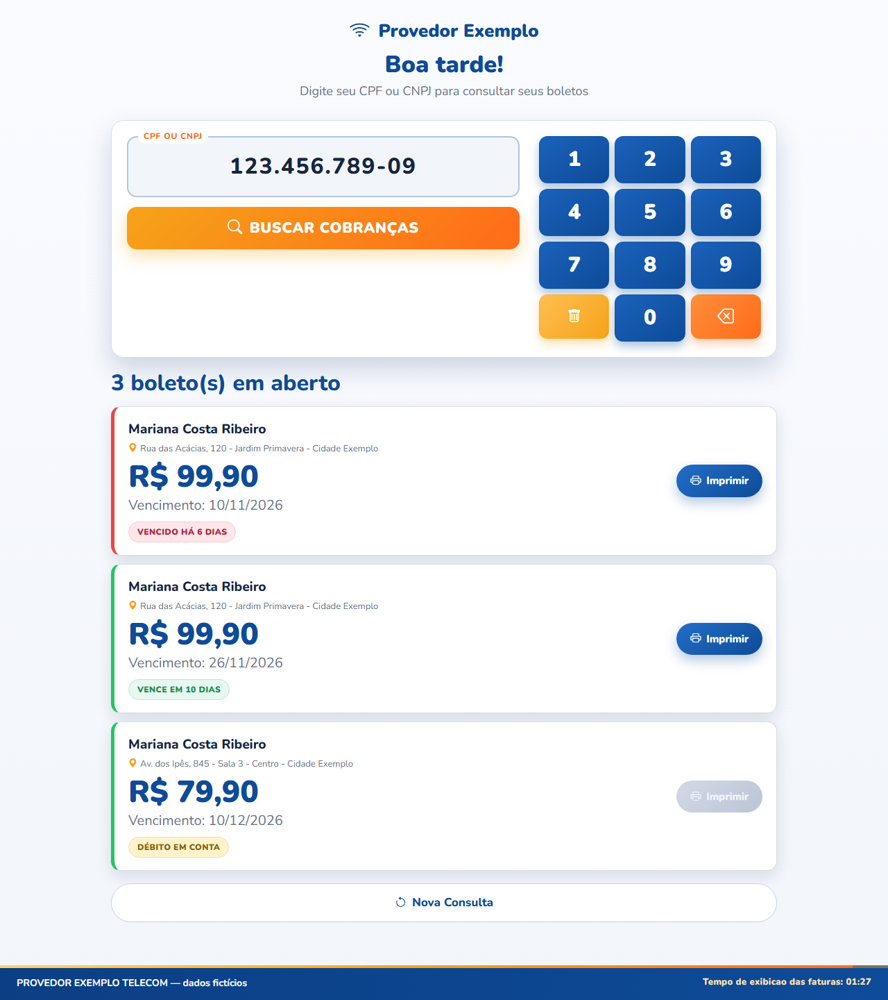
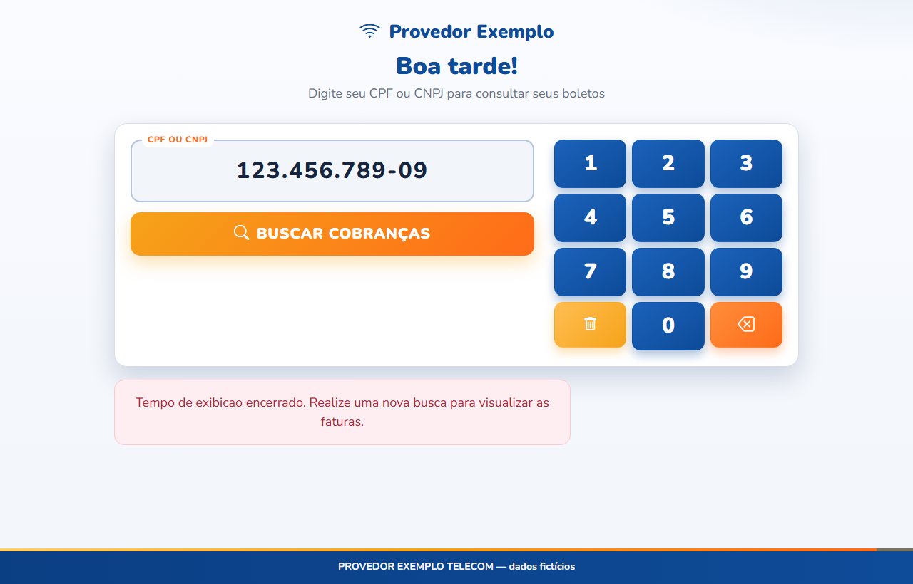
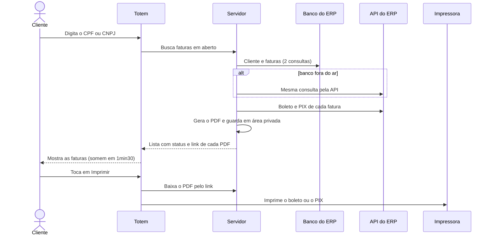
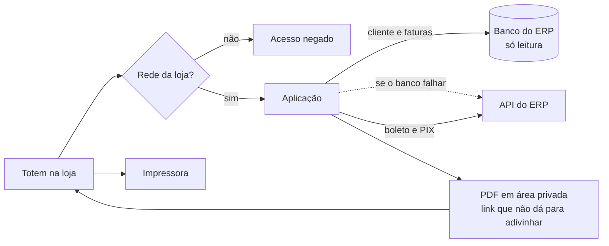

# Autoatendimento de boletos

Fiz este totem para as lojas de um provedor de internet. O cliente digita o CPF, vê as faturas em aberto e imprime a que quiser, sem pegar fila no balcão. Está em produção.

O projeto partiu de um sistema simples que já existia. Refiz a tela, a busca e a segurança. O código é da empresa, então aqui ficam a história, as telas e os diagramas.

## O problema

Muita gente ia à loja só para pegar a segunda via do boleto. O atendente parava o que estava fazendo, procurava o cliente no ERP e imprimia. Isso enchia a fila de quem tinha problema de verdade.

## O que o sistema faz

O cliente digita o CPF ou CNPJ no teclado da tela. O sistema busca as faturas em aberto e mostra cada uma com valor, vencimento, endereço do contrato e situação: vencida, vence hoje ou a vencer.

Um toque em **Imprimir** sai o boleto ou o PIX na impressora da loja. Fatura em débito automático não imprime, para o cliente não pagar duas vezes.

As faturas ficam na tela por 1 minuto e meio. Depois somem sozinhas e o campo volta vazio. Assim o próximo da fila não vê os dados de quem saiu.

## Como funciona

## O que deu trabalho

- **Chamadas demais ao ERP.** Cada busca fazia dezenas de chamadas à API do ERP e corria o risco de bater no limite dela. Passei a ler direto do banco, só leitura, e juntei tudo em duas consultas fixas (antes eram de 8 a 59). Se o banco falhar, o sistema volta para a API sozinho e o cliente nem percebe.
- **Dados à vista no balcão.** É uma tela pública numa loja. Coloquei o tempo de exibição com contagem no rodapé e a limpeza automática da tela.
- **Segurança sem quebrar a impressão.** O totem só responde na rede das lojas, mesmo se alguém forjar o endereço de origem. Os PDFs ficam numa área privada e cada um tem um link que não dá para adivinhar. Tudo isso entrou sem mexer no fluxo de impressão, que já funcionava.
- **Sistema antigo.** A base era PHP antigo. Coloquei em Docker com versões travadas para o deploy sair igual toda vez.

## Tecnologias

PHP, Laravel, MariaDB, jQuery, Bootstrap, Nginx e Docker.

## Em números

2 meses de trabalho e 38 commits.

---

As telas usam dados fictícios.
